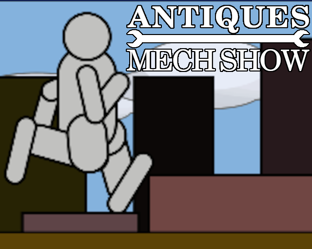

## Ludum Dare 60

**Theme:** Old Tech

**Team:** Adam Higerd

# Antiques Mech Show

You discovered a really old giant robot! The body is still in good shape, but the internals need a lot of work. If you can get it to the museum before it closes at 9:00 PM, you can see about getting it restored!

However: The only way to get it there is to pilot it! You're going to have to keep an eye on all of its systems and repair whatever breaks along the way if you want to make it in time!

## Controls

* Use a mouse or touchpad to click on buttons and broken parts.
* Drag the handle to control the throttle.
* Click the buttons on the left side to move between areas.

## Robot Operating Guide

* An illuminated button warns of a failed part.
* Click on a broken part to repair it.
* The robot will run if everything is kept repaired.
* The robot will malfunction if parts are damaged.
* Overloaded systems increase the risk of damage.
* The museum closes at 9:00. Watch the clock!
* Heating the boiler requires fuel. Opening the throttle wider uses more fuel.
* The boiler must be brought up to pressure for the robot to start moving.
* Steam leaks must be repaired before the boiler can hold pressure again.
* Burned out vacuum tubes will cause erratic behavior.

## License

Software and graphics copyright (c) 2026 Adam Higerd

Permission is hereby granted, free of charge, to any person obtaining a copy of this software and associated documentation files (the “Software”), to deal in the Software without restriction, including without limitation the rights to use, copy, modify, merge, publish, distribute, sublicense, and/or sell copies of the Software, and to permit persons to whom the Software is furnished to do so, subject to the following conditions:

The above copyright notice and this permission notice shall be included in all copies or substantial portions of the Software.

THE SOFTWARE IS PROVIDED “AS IS”, WITHOUT WARRANTY OF ANY KIND, EXPRESS OR IMPLIED, INCLUDING BUT NOT LIMITED TO THE WARRANTIES OF MERCHANTABILITY, FITNESS FOR A PARTICULAR PURPOSE AND NONINFRINGEMENT. IN NO EVENT SHALL THE AUTHORS OR COPYRIGHT HOLDERS BE LIABLE FOR ANY CLAIM, DAMAGES OR OTHER LIABILITY, WHETHER IN AN ACTION OF CONTRACT, TORT OR OTHERWISE, ARISING FROM, OUT OF OR IN CONNECTION WITH THE SOFTWARE OR THE USE OR OTHER DEALINGS IN THE SOFTWARE.
